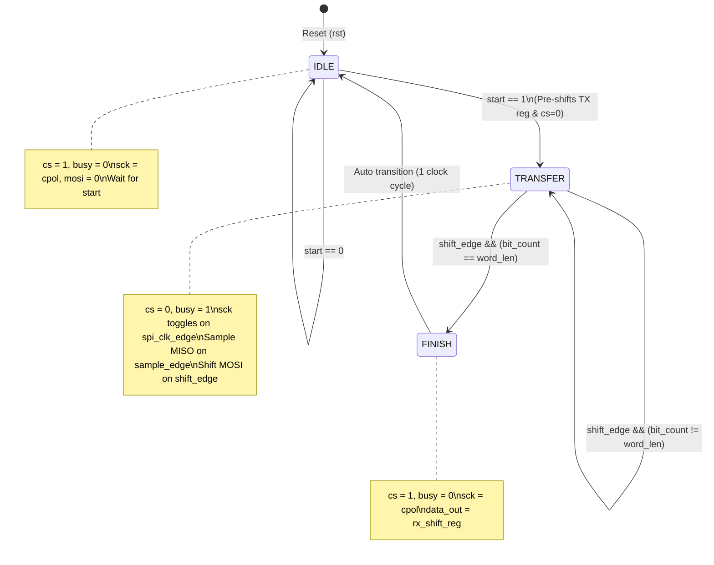

# Advanced Parameterizable SPI Master (`master_adv.v`)

This directory contains the implementation of a highly flexible, parameterizable **Serial Peripheral Interface (SPI) Master** designed in Verilog. It supports variable word lengths, configurable clock polarity and clock phase, and dynamically divides the system clock to generate the SPI serial clock.

---

## 📋 Features

- **Parameterizable Data Width**: Set the maximum shift-register width using the `MAX_WIDTH` parameter (defaults to `16` bits).
- **Dynamic Word Length**: Specify the exact number of bits (`word_len`) to transmit and receive per transaction (`1 <= word_len <= MAX_WIDTH`).
- **Full SPI Mode Support**: Configure both Clock Polarity (`cpol`) and Clock Phase (`cpha`) dynamically via input ports.
- **Integrated Clock Divider**: Generates the SPI clock (`sck`) using the `CLK_DIV_MAX` parameter.
- **Active-Low Slave Select**: Automatic management of the chip select (`cs`) line during transfers.
- **Transaction Status**: Indicates progress using the active-high `busy` signal.

---

## 🔌 Interface & Port Definitions

### Ports

| Port Name  | Direction | Bit-Width         | Description                                       |
| ---------- | --------- | ----------------- | ------------------------------------------------- |
| `clk`      | Input     | `1`               | System clock.                                     |
| `rst`      | Input     | `1`               | Asynchronous active-high reset.                   |
| `start`    | Input     | `1`               | Asserts high to initiate an SPI transaction.      |
| `data_in`  | Input     | `[MAX_WIDTH-1:0]` | Parallel data to be transmitted.                  |
| `miso`     | Input     | `1`               | Master In Slave Out serial input line.            |
| `cpha`     | Input     | `1`               | Clock Phase control.                              |
| `cpol`     | Input     | `1`               | Clock Polarity control.                           |
| `word_len` | Input     | `[4:0]`           | Configured bit length of the current transaction. |
| `mosi`     | Output    | `1`               | Master Out Slave In serial output line.           |
| `sck`      | Output    | `1`               | SPI Serial Clock output.                          |
| `cs`       | Output    | `1`               | Active-low Chip Select (Slave Select).            |
| `data_out` | Output    | `[MAX_WIDTH-1:0]` | Parallel received data bus.                       |
| `busy`     | Output    | `1`               | High when an SPI transfer is active.              |

### Parameters

| Parameter     | Type        | Default Value | Description                                           |
| ------------- | ----------- | ------------- | ----------------------------------------------------- |
| `MAX_WIDTH`   | Integer     | `16`          | Maximum data width of the SPI shift registers.        |
| `CLK_DIV_MAX` | `reg [7:0]` | `8'd7`        | Threshold for generating the SPI clock (`sck`) ticks. |

---

## ⚙️ SPI Operating Modes

The master module determines the sampling and shifting edges of the SPI clock (`sck`) dynamically based on `cpol` and `cpha`.

| SPI Mode | CPOL | CPHA | Clock Idle State | Leading Edge | Trailing Edge | Sample Edge        | Shift Edge         |
| -------- | ---- | ---- | ---------------- | ------------ | ------------- | ------------------ | ------------------ |
| **0**    | `0`  | `0`  | Low (`0`)        | Rising       | Falling       | Rising (1st Edge)  | Falling (2nd Edge) |
| **1**    | `0`  | `1`  | Low (`0`)        | Rising       | Falling       | Falling (2nd Edge) | Rising (1st Edge)  |
| **2**    | `1`  | `0`  | High (`1`)       | Falling      | Rising        | Falling (1st Edge) | Rising (2nd Edge)  |
| **3**    | `1`  | `1`  | High (`1`)       | Falling      | Rising        | Rising (2nd Edge)  | Falling (1st Edge) |

### Edge Detection Assignments

The internal edge signals are defined asynchronously based on system-clock-aligned edge detection:
- `sck_rising = (sck == 1'b1 && sck_prev == 1'b0)`
- `sck_falling = (sck == 1'b0 && sck_prev == 1'b1)`

```verilog
assign sample_edge = (cpha==1'b0) ? ((cpol==1'b0) ? sck_rising  : sck_falling) :
                                    ((cpol==1'b0) ? sck_falling : sck_rising);

assign shift_edge  = (cpha==1'b0) ? ((cpol==1'b0) ? sck_falling : sck_rising)  :
                                    ((cpol==1'b0) ? sck_rising  : sck_falling);
```

---

## ⏱️ SPI Clock Generation

The SPI clock frequency ($F_{sck}$) is derived from the system clock frequency ($F_{clk}$) via an internal divider counter. Toggles are triggered when `clk_div_counter == CLK_DIV_MAX`.

The frequency is calculated as:
$$F_{sck} = \frac{F_{clk}}{2 \times (N + 1)}$$
where $N$ is the clock division factor (`CLK_DIV_MAX`).

For the default `CLK_DIV_MAX = 7` ($N = 7$):
$$F_{sck} = \frac{F_{clk}}{2 \times (7 + 1)} = \frac{F_{clk}}{16}$$

---

## 🧠 Finite State Machine (FSM)

The module employs a 3-state Finite State Machine to orchestrate SPI transactions.



### FSM State Details

#### 1. `IDLE` (State `2'b00`)

- **Default State**: Tries to keep SPI pins in their default states. `cs` is de-asserted (`1'b1`), `busy` is low (`1'b0`), `mosi` is idle (`1'b0`), and `sck` is held constant at `cpol`.
- **Initiating Transaction**: When `start` goes high:
  - `cs` is asserted low (`1'b0`).
  - `busy` is pulled high (`1'b1`).
  - The parallel input word `data_in` is left-aligned into the `tx_shift_reg` to support MSB-first transmission:

    `tx_shift_reg <= data_in << (MAX_WIDTH - word_len);`
  - **CPHA = 0 Optimization**: If `cpha == 1'b0`, the first data bit must be driven onto `mosi` prior to the first clock edge. The controller pre-loads `mosi` with the MSB (`data_in[word_len-1]`) and performs a pre-shift:

    `tx_shift_reg <= (data_in << (MAX_WIDTH - word_len)) << 1;`
  - Transitions to `TRANSFER` state.

#### 2. `TRANSFER` (State `2'b01`)

- **SCLK Toggling**: Toggles `sck` every time `spi_clk_edge` goes high (determined by the clock divider counter).
- **MISO Sampling**: On the active `sample_edge`, the module shifts in the current state of `miso` into `rx_shift_reg` and increments `bit_count`:

  `rx_shift_reg <= {rx_shift_reg[MAX_WIDTH - 2:0], miso};`
  `bit_count <= bit_count + 1'b1;`
- **MOSI Shifting**: On the active `shift_edge`, the module checks if the target `word_len` is reached:
  - If `bit_count == word_len`, the FSM transitions to `FINISH`.
  - Otherwise, it drives the next bit onto `mosi` and shifts `tx_shift_reg` left:

    `mosi <= tx_shift_reg[MAX_WIDTH - 1];`
    `tx_shift_reg <= {tx_shift_reg[MAX_WIDTH - 2:0], 1'b1};`

#### 3. `FINISH` (State `2'b10`)

- **Wrapping Up**: De-asserts Chip Select (`cs <= 1'b1`), lowers the status indicator (`busy <= 1'b0`), and returns the serial clock `sck` to the idle polarity `cpol`.
- **Parallel Output Update**: Assigns the fully assembled received data to the output bus: `data_out <= rx_shift_reg`.
- Transitions back to `IDLE` state on the next system clock cycle.

---

## 🛠️ Bug Fixes & Refactoring

The following critical issues were identified in the original code and have been resolved:

### 1. Corrected `sck_prev` Tracking (Dynamic Edge Detection)

- **Previous Issue**: `sck_prev` was only updated during `IDLE` reset routines and not updated in active states. This prevented subsequent SPI clock edges from being registered after the first toggle.
- **Resolution**: Added `sck_prev <= sck;` inside the non-reset branch of the main sequential process. This dynamically tracks clock edges throughout the `TRANSFER` and `FINISH` states.

### 2. Syntax Cleanups in Parameter & Port Lists

- **Previous Issue**: The module declaration header contained illegal semicolons separating parameters (`parameter MAX_WIDTH = 16; ...`) and ports (`input wire [MAX_WIDTH-1:0] data_in;`), causing standard simulator compilation errors.
- **Resolution**: Standardized the header list to use comma separation, aligning with modern Verilog standards.

### 3. Validated Replication Operators

- **Previous Issue**: The reset declarations inside the sequential block used parentheses instead of brackets for bit replication (`{MAX_WIDTH(1'b0)}`).
- **Resolution**: Updated syntax to proper replication operators `{MAX_WIDTH{1'b0}}` for variables `tx_shift_reg`, `rx_shift_reg`, and `data_out`.

---

